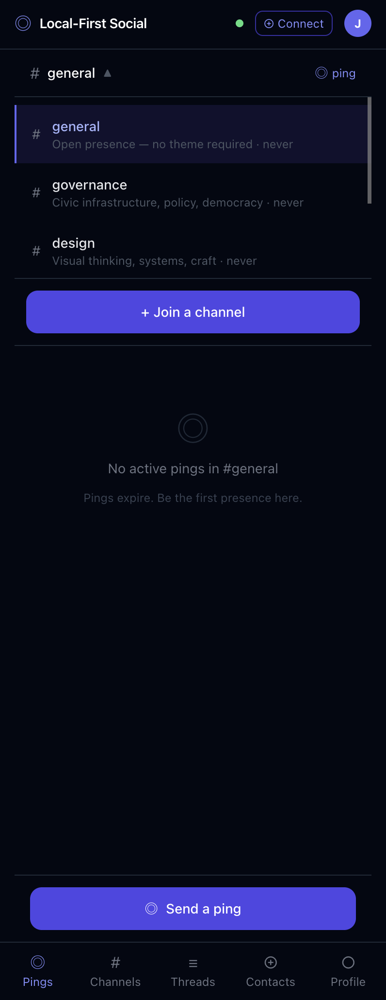
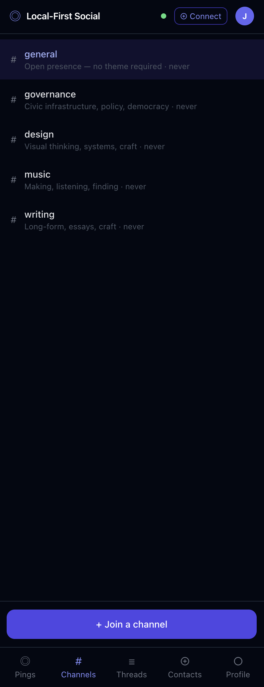
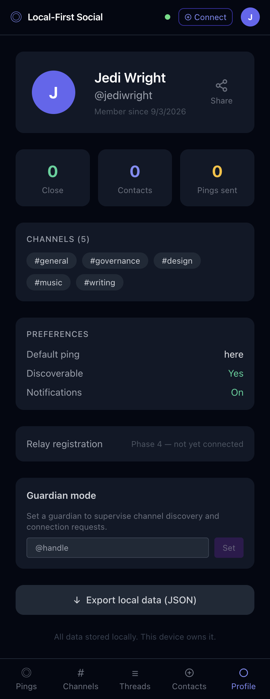

# Local-First.Social

A social network where you own your graph. The relay has no database: it passes messages between people who have agreed to connect, and forgets the connection when either one leaves. The platform never accumulates your relationship data.

**Live:** [localfirst.social](https://localfirst.social)

Find me at [localfirst.social/#/connect/@jediwright](https://localfirst.social/#/connect/@jediwright).

---

## Who this is for

If you've felt the cost of building relationships on platforms that 
own them — a deplatformed community, a contacts list you can't export, 
a history that disappears when you leave — this is built for you.

Local-First Social is for people who want presence without performance. 
Depth without breadth. Connection that doesn't require handing your 
social graph to a server that monetizes it.

You don't need to understand the technical details, like CRDTs, to use it. You just need to care 
about who owns your data and relationships.

---

## What it is

Local-First Social is a social network built on a different architectural premise: your content, connections, and history live on your device first. The server is minimal by design — it introduces two people, passes their sync messages while both are online, and stores none of it.

The social primitive is the **ping** — a low-friction, intentional signal. Not a post optimized for engagement. Not a message requiring a response. A ping says: *I'm here. I'm thinking about this. You're in my circle.*

Five ping types:

| Type | Signal |
|---|---|
| `here` | Presence — I'm around |
| `check-this` | Share — worth your attention |
| `thinking-of-you` | Relationship maintenance, no response expected |
| `let's-connect` | Invitation to start a thread |
| `status` | What I'm working on, where I am |

Pings expire. They don't accumulate into a feed you have to clear. The pattern of who pings whom, about what, and how often is what builds the social graph — and that graph lives on your device.

---

## Architecture

All application state lives in a single Y.js document persisted to IndexedDB via `y-indexeddb`. There is no user database, no server-side session, no backend that owns your relationships.

```
client (Y.js / IndexedDB)
    ↕ WebSocket
relay (no database — connects two people, forwards sync while both are online)
    ↕ WebSocket
client (Y.js / IndexedDB)
```

**Three operations go through the relay:**

1. Connection request — client A signals intent to client B; the relay passes the request and the answer
2. Thread sync — CRDT merge of thread history between connected clients, and the live updates that follow while both are online
3. Channel discovery — lightweight interest-channel presence signal, no content stored server-side

The relay forwards sync messages only between two people whose connection request was accepted, and only while both are still connected to it. When either one leaves, it forgets the connection. It keeps no copy of what it forwards. Your threads, pings, and contact list are yours — before they're anyone else's.

Each of these three operations is a *crossing*: a moment where data leaves the device. How crossings are gated and recorded is governed by [`SEAM_DECISIONS.md`](SEAM_DECISIONS.md). Design tradeoffs that might look like gaps are explained in [`KNOWN_LIMITS.md`](KNOWN_LIMITS.md).

**Stack:**

- React + TypeScript + Tailwind
- Y.js + y-indexeddb (local-first state)
- WebSocket relay on Fly.io (in-memory only, persistent connections)
- Deployed on Vercel

---

## Features

**Pings**
- Five ping types with configurable TTL (24h to 30 days)
- Interest channels — opt-in, no algorithm, no follower count
- Ping streaks and daily activity tracking
- Save and share pings; URLs in ping content are clickable
- TTL progress bar on each ping card

**Threads**
- Full conversation history, owned locally
- Persists offline — readable after any prior online session
- Asset library — links and files shared in threads, searchable
- Messages sorted by timestamp; CRDT merge preserves order across devices

**Contacts**
- Trust graph stored locally as Y.Map
- Four trust tiers: `close`, `contact`, `discoverable`, `guardian`
- Backfilled from thread history on load — contacts appear even without a fresh connection
- Guardian mode for supervised accounts

**Connection**
- Share link: `localfirst.social/#/connect/@handle` — opens app pre-filled for new and existing users
- Profile card share button copies your link to clipboard
- CRDT sync merges thread history from both sides

---

## Screenshots

| | | |
|---|---|---|
|  |  |  |
| Pings — intentional signals, not a feed | Channels — opt-in, no algorithm | Profile — all data stored locally. You and your device own it. |

---

## Design Principles

1. **Presence, not performance.** Rewards being here, not going viral.
2. **Ownership, not access.** Your data is yours before it's the platform's. Export is a first-class feature.
3. **Depth, not breadth.** 50 real pings beat 5,000 followers.
4. **Intentionality, not optimization.** No algorithm decides who you see.
5. **Portability as a feature.** Full export, open format, no lock-in.
6. **The relay earns nothing.** Infrastructure connects people and passes their messages. It does not accumulate relationship data.

---

## Data Model

```
doc.getMap('profile')      → identity, preferences, trust graph
doc.getMap('pings')        → ephemeral ping state, keyed by channel
doc.getMap('threads')      → persistent thread history, keyed by contactId
doc.getMap('channels')     → interest channel memberships
doc.getMap('assets')       → thread asset library, keyed by assetId
```

The trust graph is a `Y.Map` nested inside `profile` — not a server-side database. Tier assignments, connection history, and sync status are all local-first state.

Two further maps, `crossing_intents` and `crossing_records`, are specified in [`src/types/crossing.ts`](src/types/crossing.ts) and land with the Phase 4 governance work (see Status).

---

## Running Locally

```bash
git clone https://github.com/jediwright/local-first-social-network
cd local-first-social-network
npm install
cp .env.example .env.local
npm run dev
```

`.env.example` points at the production relay, so the app works against live infrastructure out of the box. To run your own relay for two-tab testing:

```bash
node relay/server.js
```

then set `VITE_RELAY_URL=ws://localhost:8080` in `.env.local` and restart `npm run dev`. The relay has its own dependencies: run `npm ci` in `relay/` first.

---

## Tests

Four scripts, run from the repository root after `npm ci` at the root and in `relay/`. Each starts its own relay on a spare local port; none touches a deployed relay.

```bash
node relay/test/pairing.mjs          # which messages the relay forwards between two handles
node relay/test/malformed-input.mjs  # the relay refuses malformed messages and keeps running
node relay/test/payload-limit.mjs    # the 4 MiB message limit
node test/sync-guards.mjs            # who the client will sync with
```

`test/sync-guards.mjs` replaces IndexedDB with a stub, so persistence is not covered. The two memory measurements in `relay/test/payload-limit.mjs` are taken on Linux only.

---

## Relay

The relay is deployed on Fly.io. It has no database; what it knows is held in memory. That is two things: the handle registry, and which pairs of connected people are both online. Both are ephemeral. A crash and restart loses no content, because all content is client-side. Clients reconnect and re-register on their own, and two people who were syncing live send a new connection request to resume (this is deliberate; see [`KNOWN_LIMITS.md`](KNOWN_LIMITS.md)).

```bash
curl https://local-first-social-relay.fly.dev/health
# {"status":"ok","handles":N,"channels":N}
```

---

## Part of the Local-First Prototype Series

This is one of the prototypes in the [Local-First Series](https://github.com/jediwright/local-first-series), which explores local-first architecture across domains:

| Prototype | Domain | Seam |
|-----------|--------|------|
| Governance Window Tracker | Civic intelligence | None — read-only |
| checkout-seam | Commerce | Once per purchase (Stripe) |
| fhir-seam | Healthcare intake | Once per submission (FHIR) |
| **Local-First Social** | **Social networking** | **Every new connection** |
| [employment-seam](https://github.com/jediwright/employment-seam) | Employment relationship | Every transition in the employer–worker relationship |

Each prototype introduces a harder version of the seam problem. Local-First Social's seam fires on every new connection, and the thing on the far side is another user's local-first client, not a stateless server — the series calls this the *distributed seam*. The employment seam that followed extends the same pattern into a regulated, multi-party relationship; the [Seam Stack](https://github.com/jediwright/seam-stack) documents its formalization.

The architectural argument: a social network where the user owns the graph, the relay connects people and passes their messages without storing either, and the platform never accumulates relationship data.

---

## Status

**Phase 5 complete as of April 2026.** Real-time bidirectional messaging, CRDT sync, trust graph, channels, ping streaks, share links, and asset library all working in production.

**November 2026.** The relay now forwards sync messages only between two people whose connection request was accepted, and forgets a connection when either one leaves. The client acts on handshake and sync messages only inside a connection the user took part in.

**Phase 4 governance retrofit in progress (September 2026).** The relay and connection protocol already work; what's being added is the governance layer around them, under [`SEAM_DECISIONS.md`](SEAM_DECISIONS.md). The most visible change coming: connecting with someone will no longer automatically sync thread history. Accepting a request makes you *connected*; sharing history requires the user to set a trust level themselves. Every relay operation will also write a local record of what crossed and why.

---

## Get involved

Local-First Social is an open architecture, not a finished product. 
If you're building in the local-first space, researching platform 
alternatives, or thinking about what healthier social software looks 
like structurally — this is worth poking at.

- **Try it:** [localfirst.social](https://localfirst.social)
- **Run it locally:** see Running Locally above
- **Read the argument:** [Full Personhood](https://systemsofthought.com/full-personhood/) — the governance case this architecture serves
- **Follow the build:** [Systems of Thought](https://systemsofthought.com) — where the work is documented as it happens
- **Reach out:** [jedi@jediwright.com](mailto:jedi@jediwright.com)

---

*Built by [J. Wright](https://systemsofthought.com) / UX Minds, LLC*
*AI-collaborative synthesis, human authorial responsibility held by J. Wright.*
*Methodology: [Systems of Thought](https://systemsofthought.com)*
